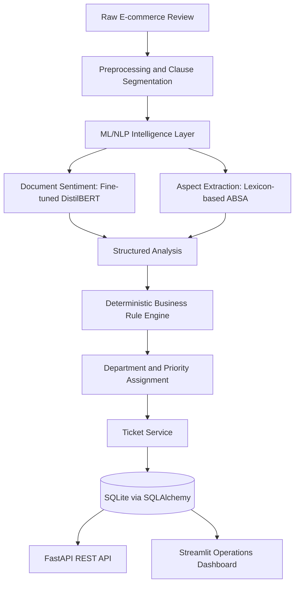

# Intelligent Review Router

**A Hybrid Transformer and Rule-Based Pipeline for Aspect-Aware Customer Support Ticket Routing**

Intelligent Review Router is an end-to-end NLP system that converts free-text e-commerce reviews into prioritised support issues. It combines document-level sentiment classification with lexicon-driven aspect-based sentiment analysis (ABSA), then applies deterministic business rules to assign departments and escalation priorities.

The system is designed as a practical support-triage demonstrator. Its evaluation also identifies an important limitation: the current aspect extractor misses many issues in multi-aspect reviews, which directly affects department routing and urgent-ticket detection.

---

## Table of Contents

- [Problem and Objective](#problem-and-objective)
- [System Architecture](#system-architecture)
- [NLP Methodology](#nlp-methodology)
- [Aspect Taxonomy](#aspect-taxonomy)
- [Routing and Priority Rules](#routing-and-priority-rules)
- [Dataset and Experimental Setup](#dataset-and-experimental-setup)
- [Evaluation Results](#evaluation-results)
- [Known Limitations](#known-limitations)
- [Backend and Dashboard](#backend-and-dashboard)
- [Technology Stack](#technology-stack)
- [Repository Structure](#repository-structure)
- [Setup and Execution](#setup-and-execution)
- [API Endpoints](#api-endpoints)
- [Future Work](#future-work)

## Problem and Objective

A single customer review can contain multiple complaints owned by different teams. Document-level sentiment alone cannot identify which operational issue needs attention.

For example:

> The phone is excellent, but delivery was very late and my refund has not arrived.

A support system needs to distinguish the product praise from the delivery and refund complaints, identify the relevant departments, and determine the escalation priority.

**Project objective:** build a modular pipeline that preprocesses reviews, predicts overall sentiment, extracts aspect-level issues, applies transparent routing rules, and creates support tickets for actionable feedback.

## System Architecture

The system is organised into four layers with unidirectional data flow.



1. **Ingestion and preprocessing:** cleans review text and splits it into clauses.
2. **ML/NLP intelligence:** predicts document-level sentiment and extracts aspect/opinion information.
3. **Business routing:** maps extracted issues to departments and computes issue-level and overall priority.
4. **Persistence and presentation:** assembles tickets, persists records, exposes REST endpoints, and provides an operations dashboard.

The routing engine is rule-based rather than a learned classifier. This keeps department ownership and escalation policy explicit, deterministic, and easier to audit or update.

## NLP Methodology

### 1. Text preprocessing and clause segmentation

The preprocessing stage:
- Removes HTML markup.
- Normalises and collapses whitespace.
- Splits text at sentence terminators.
- Splits at contrastive discourse markers such as `but`, `however`, `although`, `furthermore`, and `yet` when preceded by a comma.
- Discards fragments of three characters or fewer.

Clause segmentation is important because a review can contain opposing opinions in one sentence. For example, “The phone is excellent, but delivery was late” contains positive product feedback and a negative delivery complaint.

### 2. Document-level sentiment classification

The primary sentiment model is a fine-tuned **`distilbert-base-uncased`** sequence classifier with three output classes:

- `Positive`
- `Neutral`
- `Negative`

Model configuration:

| Parameter | Value |
|---|---:|
| Backbone | `distilbert-base-uncased` |
| Transformer encoder layers | 6 |
| Attention heads | 12 |
| Hidden dimension | 768 |
| Trainable parameters | 66,955,779 |
| Maximum sequence length | 128 tokens |
| Classification head | 768 → 3 logits |
| Optimiser | AdamW |
| Learning rate | 0.00003 |
| Weight decay | 0.01 |
| Batch size (train/eval) | 16 / 16 |
| Maximum epochs | 3 |
| Checkpoint selection | Best weighted F1 |

The tokenizer converts review text into token IDs and attention masks. DistilBERT produces contextual representations; the pooled `[CLS]` representation is passed to a linear classification head. Softmax converts the three logits into class probabilities.

The service also supports graceful degradation if the fine-tuned model artefact is unavailable. Its documented resolution order is:
1. Fine-tuned DistilBERT.
2. Persisted TF-IDF baseline.
3. In-memory logistic regression model fitted on exemplar strings.
4. Lexicon heuristic.

The selected model variant is recorded with each analysis.

### 3. Aspect-Based Sentiment Analysis (ABSA)

Aspect extraction is **lexicon-driven**, not a BART-MNLI zero-shot classifier and not a trained neural aspect-span model.

The extractor operates clause by clause:
1. Counts keyword matches for each of the six aspect categories.
2. Selects the single highest-scoring aspect category for that clause.
3. Determines aspect polarity by counting matches in positive and negative opinion lexicons.
4. Uses the majority opinion polarity.
5. If positive and negative counts tie, falls back to the document-level classifier applied to that clause.
6. Assigns a confidence heuristic based on the winning lexicon-hit count.

Two implementation constraints are important:
- At most one aspect is emitted per clause.
- An aspect already emitted for the review is suppressed, so the same aspect is emitted at most once per review.

If no aspect is detected, the review is assigned `product_quality` with neutral polarity so that it is not silently dropped.

These constraints explain much of the aspect-recall limitation reported in the evaluation.

## Aspect Taxonomy

The paper defines six aspects and their owning departments.

| Aspect | Department | Critical? |
|---|---|---|
| `delivery` | Logistics | No |
| `product_quality` | Product Support | No |
| `payment` | Payments | Yes |
| `refund_return` | Refunds | Yes |
| `packaging` | Returns / Replacement | No |
| `customer_support` | Customer Support | No |

Payment and refund/return are treated as critical because they involve direct financial exposure to the customer.

## Routing and Priority Rules

The business rule engine consumes the extracted issue list. It does not learn department assignment from the sentiment model.

For each issue:
- Negative critical aspect (`payment` or `refund_return`) → `HIGH`.
- Negative non-critical aspect → `MEDIUM`.
- Non-negative aspect → `LOW`.

Overall priority is then calculated from the number of negative aspects and whether at least one negative aspect is critical:

| Condition | Overall priority |
|---|---|
| At least 2 negative aspects, including a critical aspect | `URGENT` |
| At least 1 negative critical aspect, or 2+ negative aspects | `HIGH` |
| Exactly 1 negative aspect (non-critical) | `MEDIUM` |
| No negative aspects | `LOW` |

The primary department is the owner of the highest-priority routed issue.

A support ticket is automatically created when overall sentiment is negative or overall priority is `HIGH` / `URGENT`.

## Dataset and Experimental Setup

Because a public dataset with all required annotations was not available, the study uses a programmatically synthesised e-commerce review corpus.

| Dataset property | Value |
|---|---:|
| Total reviews | 1,500 |
| Training reviews | 1,200 |
| Held-out test reviews | 300 |
| Split | Stratified 80/20 |
| Random seed | 42 |
| Aspect categories | 6 |
| Sentiment classes | 3 |
| Total aspect mentions | 2,499 |

The corpus was generated using curated positive, neutral, and negative opinion phrases, product nouns, and surface templates. Approximately 45% of reviews were designed as multi-aspect reviews.

**Important:** this is a synthetic, template-generated corpus. Results should not be interpreted as evidence of equivalent performance on organic customer reviews.

### TF-IDF baseline

A baseline was trained using:
- TF-IDF unigram and bigram features.
- Maximum feature setting: 10,000 (1,085 terms realised in this corpus).
- Multinomial Logistic Regression.
- The same train/test split as DistilBERT.

The baseline is also the first fallback in the sentiment service's model-resolution chain.

### Compute environment

Experiments were conducted CPU-only on:
- 12th-generation Intel Core i5-12450HX (12 logical cores).
- 15.7 GB RAM.
- Python 3.13.5.
- PyTorch 2.14.0 CPU build.
- Transformers 5.17.0.
- scikit-learn 1.9.1.

**No GPU was used for training or inference.**

## Evaluation Results

All classification results below are reported on the held-out set of 300 reviews.

### Sentiment classification

| Model | Accuracy | Weighted F1 |
|---|---:|---:|
| TF-IDF + Logistic Regression | 96.00% | 96.06% |
| Fine-tuned DistilBERT | **96.33%** | **96.41%** |

DistilBERT improves accuracy by only 0.33 percentage points over the TF-IDF baseline. The baseline is approximately 780× faster per review on this corpus.

### Aspect extraction

| Metric | Result |
|---|---:|
| Micro precision | 91.18% |
| Micro recall | 60.78% |
| Micro F1 | 72.94% |
| Exact aspect-set match | 53.67% |

Aspect extraction has high precision but substantially lower recall. Recall falls as the number of aspects in a review increases:

| Gold aspects in review | Aspect recall |
|---:|---:|
| 1 | 90.12% |
| 2 | 58.33% |
| 3 | 40.28% |

### Department and priority routing

| Evaluation | Accuracy |
|---|---:|
| Primary department routing | 69.33% |
| Overall priority assignment | 80.67% |

The priority accuracy alone is misleading because performance drops sharply for severe cases:

| Priority | Precision | Recall | F1 |
|---|---:|---:|---:|
| LOW | 97.44% | 95.80% | 96.61% |
| MEDIUM | 75.42% | 94.68% | 83.96% |
| HIGH | 62.71% | 67.27% | 64.91% |
| URGENT | 33.33% | **6.25%** | 10.53% |

**Operational safety finding:** only 2 of 32 genuinely URGENT reviews were recognised. The under-escalation rate was 16.00% (48 of 300 reviews).

### Inference latency (CPU-only)

| Stage | Mean latency |
|---|---:|
| TF-IDF baseline | 0.0139 ms |
| DistilBERT sentiment | 10.84 ms |
| Full end-to-end pipeline | 15.61 ms |

The full pipeline's p50 latency was 14.07 ms, p95 was 24.74 ms, and p99 was 28.27 ms.

## Known Limitations

The results must be read alongside the following limitations identified in the study.

1. **Synthetic data and train/test overlap:** 31.67% of held-out reviews occur verbatim in the training set. DistilBERT accuracy is 1.0000 on these overlapping examples and 0.9463 on the 205 unseen examples. The headline score is therefore optimistic.
2. **No independent validation split:** the same held-out set was used for checkpoint selection and final reporting. A separate validation set and one-time final test evaluation are required.
3. **Aspect extraction recall:** the extractor emits at most one aspect per clause and suppresses duplicate aspects within a review. This creates a structural recall ceiling for multi-issue reviews.
4. **Lexicon matching weaknesses:** unanchored substring matching can create false positives (for example, matching “late” inside “chocolate”), and the opinion lexicons do not handle negation scope.
5. **Routing inherits upstream errors:** the rule engine is deterministic and contributes no independent priority error when given the correct issue list. Missed aspects propagate into incorrect department and priority decisions.
6. **URGENT detection is weak:** urgent recall is only 6.25%, so the current implementation must not be treated as a production-ready safety-critical triage system.
7. **Department metric caveat:** the dataset's gold department convention does not always match the router's highest-priority-issue convention. The reported 69.33% department accuracy therefore mixes extraction errors with a label-definition mismatch.
8. **Scope constraints:** the taxonomy covers one domain, six aspects, and one language. The hand-curated lexicons need re-authoring for other domains or languages.
9. **Persistence and deployment topology:** SQLite uses a single-process write model and is not intended for concurrent production load. In the container deployment described in the paper, Streamlit instantiates service classes in-process instead of calling the FastAPI REST API; the dashboard therefore bypasses the API and the two processes do not share state.

The project is a research demonstrator, not a production-ready autonomous support system. Human review is particularly important for high-impact financial complaints and urgent cases.

## Backend and Dashboard

### Backend

- **FastAPI** exposes the REST interface.
- **SQLAlchemy** provides ORM-based relational persistence.
- **SQLite** stores analysis and ticket records.
- Two tables are used:
  - `review_analyses`: complete analysis, issue list, model variant, and routing decision.
  - `support_tickets`: actionable ticket, department, priority, and lifecycle status.

Ticket lifecycle statuses:

`OPEN` → `IN_PROGRESS` → `RESOLVED` → `CLOSED`

### Streamlit dashboard

The operations dashboard provides:
- Live Analyzer.
- Support Desk Queue.
- Batch Inspector.
- Analytics.

**Deployment note:** according to the research paper, the Streamlit dashboard currently instantiates service classes in-process rather than making HTTP requests to FastAPI. The REST API and dashboard should therefore not be described as sharing state through API calls in this deployment.

## Technology Stack

| Area | Technologies |
|---|---|
| Language | Python |
| NLP / Deep Learning | PyTorch, Hugging Face Transformers, DistilBERT |
| Classical ML | scikit-learn, TF-IDF, Logistic Regression |
| Text processing | Lexicon-based aspect and opinion matching |
| Backend | FastAPI, Pydantic |
| ORM / Database | SQLAlchemy, SQLite |
| Dashboard | Streamlit |
| Testing | Pytest |
| Deployment | Docker, Docker Compose |

## Repository Structure

The repository is organised around the application services, data preparation, experiments, and tests.

```text
.
├── app/
│   ├── main.py
│   ├── api/
│   │   └── routes.py
│   ├── services/
│   │   ├── preprocessing.py
│   │   ├── sentiment.py
│   │   ├── aspect_extraction.py
│   │   ├── routing.py
│   │   └── ticket_service.py
│   ├── models/
│   │   └── trained_model/
│   └── db/
│       ├── database.py
│       └── models.py
├── data/
│   ├── build_dataset.py
│   ├── raw/
│   └── processed/
├── notebooks/
│   ├── 01_eda.ipynb
│   ├── 02_sentiment_baseline.ipynb
│   ├── 03_transformer_sentiment.ipynb
│   └── 04_aspect_extraction.ipynb
├── tests/
├── train_transformer.py
├── streamlit_app.py
├── pyproject.toml
└── README.md
```

## Setup and Execution

The following commands describe the project workflow documented in the repository. Run them from the project root.

### 1. Install dependencies

```bash
uv sync
```

### 2. Generate the dataset

```bash
uv run python data/build_dataset.py
```

### 3. Train the sentiment model

```bash
uv run python train_transformer.py
```

The research experiments used CPU-only training. Training time depends on the machine and installed dependencies.

### 4. Start the FastAPI backend

```bash
uv run uvicorn app.main:app --reload --port 8000
```

Open the interactive API documentation at:

`http://127.0.0.1:8000/docs`

### 5. Start the Streamlit dashboard

In a separate terminal:

```bash
uv run streamlit run streamlit_app.py
```

### 6. Run tests

```bash
uv run pytest tests/
```

### Docker Compose

If the repository's Docker Compose configuration is available:

```bash
docker compose up --build
```

The paper describes the backend at `http://localhost:8000` and the Streamlit dashboard at `http://localhost:8501`. See the deployment note above regarding the dashboard's in-process service usage.

## API Endpoints

The documented REST surface includes:

| Method | Endpoint | Purpose |
|---|---|---|
| POST | `/api/v1/analyze` | Analyse a customer review |
| POST | `/api/v1/tickets` | Manually create a support ticket |
| GET | `/api/v1/tickets` | Retrieve tickets, with department/priority/status filters |
| PATCH | `/api/v1/tickets/{id}` | Update ticket lifecycle status |
| GET | `/api/v1/analytics` | Retrieve aggregate operational metrics |

## Future Work

The research identifies the following improvement priorities:

1. Replace the synthetic corpus with organically collected and manually annotated customer reviews.
2. Use a separate train/validation/test split to avoid optimistic model-selection results.
3. Allow multiple aspects to be extracted from each clause and remove per-review duplicate suppression where appropriate.
4. Replace substring matching with word-boundary-aware matching and add negation-scope handling.
5. Explore a supervised aspect-term extraction model when sufficient annotated data is available.
6. Incorporate document-level sentiment explicitly into escalation logic.
7. Use recall-oriented thresholds for critical payment and refund aspects.
8. Move from SQLite to a database designed for concurrent workloads.
9. Make the Streamlit dashboard communicate with FastAPI through the REST API so the deployed topology matches the intended architecture.

---

## Research Paper

The implementation details, experimental protocol, results, error analysis, and limitations are documented in the accompanying research paper:

**“Intelligent Review Router: A Hybrid Transformer and Rule-Based Pipeline for Aspect-Aware Customer Support Ticket Routing.”**

